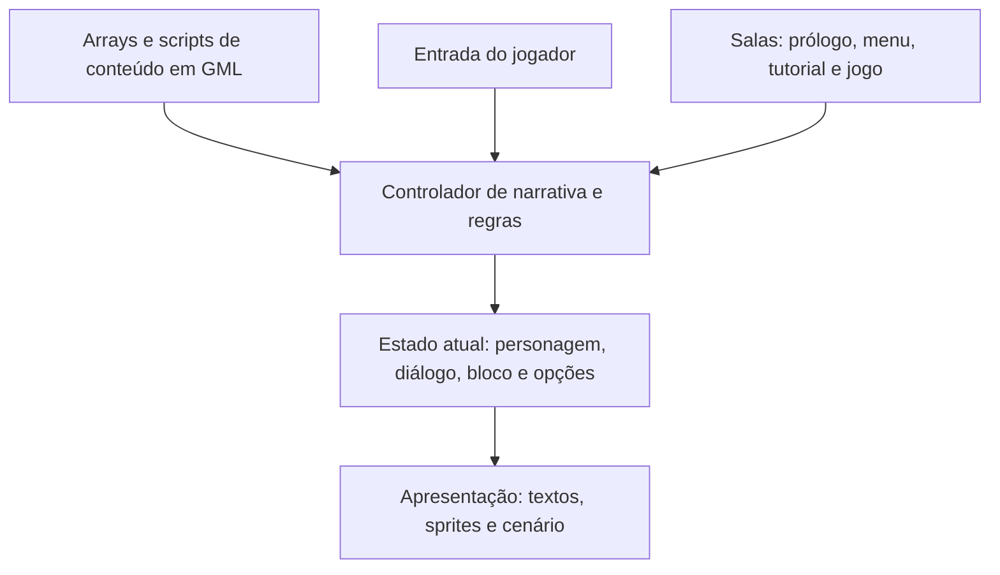
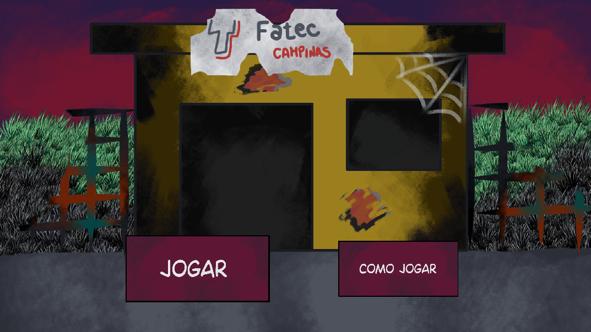
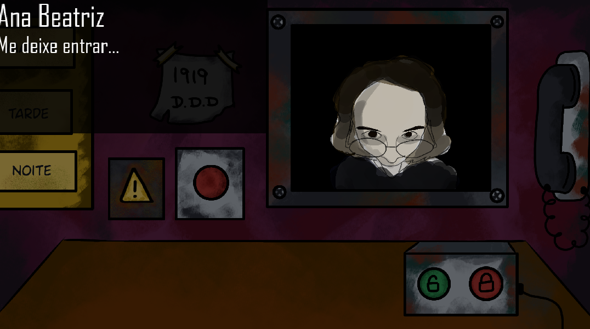
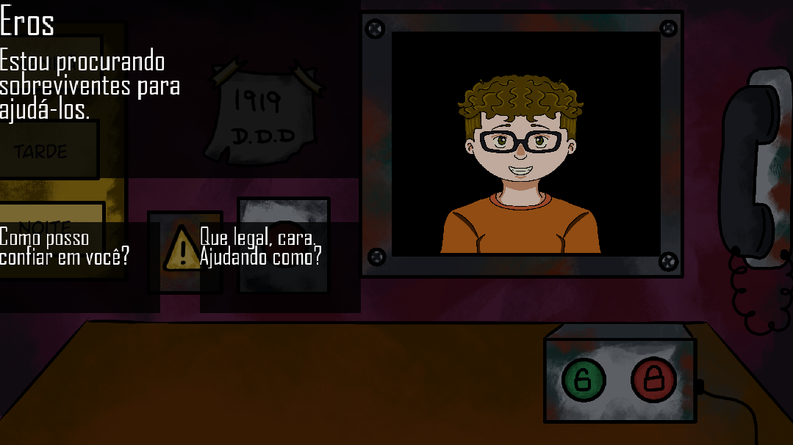

### 👥Equipe
- **GAMEDEVS BROS**;
### 👤Integrantes
- **Daiane Cristina Rocha - ADS 4º semestre;**
- **Heitor Rodrigues Gomes Birai - ADS 2º semestre;**
- **Ricardo Gabriel Camargo Soares - ADS 4º semestre;**

### ✏️Título Oficial 
- **FEARTEC**: : The Halloween Disease;

### 💻Ferramenta de Desenvolvimento
- **GameMaker Studio 2** ;

### 📃Descrição Geral do Projeto
- Jogo desenvolvido com base em dois jogos já existentes: **That's Not My Neighbor** e **I'm Not Human**;.
-  **Estilo de jogo**: Simulação de trabalho;
-  **Gênero**: Terror e suspense; 
-  **O que o player irá fazer**: O papel do player é exercer o serviço de guarda na guarita da Fatec após um apocalipse de halloween ao qual vários inimigos vão se transformar em alunos e tentar entrar na faculdade, e a partir de um diálogo simples terá que decidir se é o aluno real ou um *doppelgänger*;

###  ✏️Como o Tema foi Abordado no Projeto
-  O tema Halloween foi abordado nos backgrounds do jogo e na criação dos personagens; 

###  ⚙️Arquitetura da Solução Adotada

### 💻Tecnologias e Padrões Utilizados no Desenvolvimento
- **Linguagem**: GML - linguagem própria do GameMaker;
- **Ferramentas**: Obsidian - A documentação escrita utilizando Markdown; GameMaker - Utilizado para desenvolvimento do projeto; Ibis Paint - Para desenvolvimentos dos backgrounds e personagens; 

### ✏️Descrição de Todas as Mudanças Entre o Relatório Inicial e o Produto Final
-  **Alteração da ferramenta de desenvolvimento**: Migramos da Godot para o GameMaker Studio 2, pois um dos membros sabia lidar melhor com a linguagem; 
-  **Adição do título oficial**: No primeiro relatório, o jogo ainda não possuía um nome oficial; 
-  **Especificações**: A descrição do projeto foi reformulada, se tornando mais curta e direta; 
-  **Tema Halloween**: Antes era apenas implícito no gênero, e agora é incorporado de forma explícita no título do projeto; 
-  **Relatório mais completo**: Agora o relatório inclui seções específicas sobre arquitetura da solução, lista de ferramentas de apoio e menciona também instruções de compilação e execução;

### 💻 Uso da IA 
- Utilizamos as IAs *Deepseek, ChatGPT  e Manus* para auxilio na hora da criação da Arquitetura do projeto e correção de bugs do código;

### 📃Instruções para Compilação, Instalação e Execução do Jogo
- Baixar a pasta; extrair os arquivos;
- Abrir o arquivo instalador, escolher o caminho e baixar o jogo; 

### 📸Capturas de Tela

-------------------------------------------------------------------------------------------------------------

-------------------------------------------------------------------------------------------------------------

